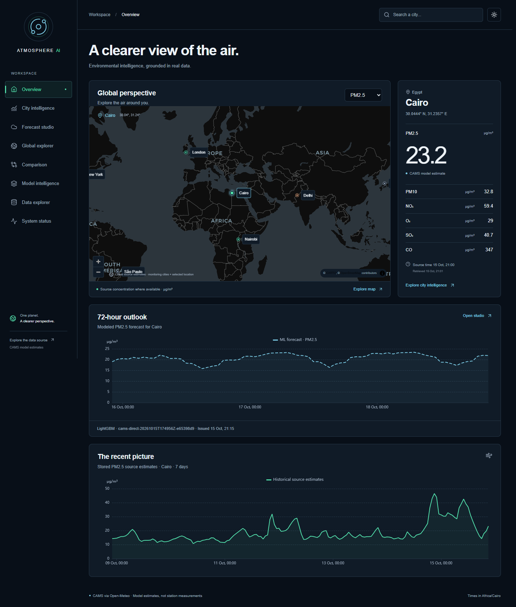

# ATMOSPHERE AI

Global air-quality intelligence and 72-hour PM2.5 forecasting. A Next.js interface, FastAPI service, PostgreSQL data store and reproducible classical machine-learning pipeline built around real Open-Meteo / CAMS data.

Environmental values are **model-derived estimates, not station measurements**. Atmosphere AI forecasts come from our own trained estimator. No synthetic environmental fallback is used.

## Run

With Docker Desktop's Linux engine running, from this directory:

```powershell
Copy-Item .env.example .env
docker compose up --build -d
docker compose exec backend python -m app.ml.collect_data --days 365
docker compose exec backend python -m app.ml.train
```

Open [Atmosphere AI](http://localhost:3000) and [API documentation](http://localhost:8000/docs). Source-data screens can work before training; forecasts explicitly report an unavailable model until training finishes. Models and the database persist in named Docker volumes.

For native Windows development with Python 3.13, Node 24 and PostgreSQL installed:

```powershell
.\scripts\start-local.ps1 -Install -BuildFrontend
cd backend
..\.venv\Scripts\python.exe -m app.ml.collect_data --days 365
..\.venv\Scripts\python.exe -m app.ml.train
```

The startup script uses a separate PostgreSQL cluster inside `.runtime` on port 5433. Pass `-PostgresBin` if PostgreSQL is installed elsewhere. Use [deployment instructions](docs/DEPLOYMENT.md) for manual terminals, alternate ports, configuration, backups and limitations.

## Product



- Worldwide city search with country/region/timezone disambiguation.
- Global overview and interactive MapLibre location explorer.
- City pollutant/weather profiles and actual historical trends.
- Forecast studio with 72 own-model hourly predictions, table, freshness, model version and coverage warnings.
- Comparison of selected cities using real source data.
- Model intelligence with actual classical-model leaderboard, evaluation and permutation importance.
- Data explorer for coverage, missingness and actual records.
- Operational status for database, source checks, ingestion, forecasts and scheduler.
- Dark/light themes, responsive navigation and explicit loading/error/empty states.

## Executed ML result

Collected **70,032 hourly air-quality records** and 70,032 weather records across Cairo, London, Delhi, New York, Tokyo, São Paulo, Sydney and Nairobi. PM2.5 missingness was zero in the executed collection. Source period: October 16, 2025 through October 15, 2026, partial current day.

Compared persistence and seasonal-naive baselines with trained Ridge, Random Forest, LightGBM and XGBoost. **LightGBM** won validation selection. Known-city future-period test MAE: **8.5785 µg/m³**; RMSE: **14.3597 µg/m³**. Unseen Nairobi MAE: **4.0520 µg/m³**; RMSE: **5.0094 µg/m³**. Raw MAEs across cities with different concentration distributions are not directly comparable evidence of generalization.

The saved artifact is `backend/artifacts/cams-direct-20261015T174956Z-e65398d9/model.joblib` in the native build workspace. Artifacts and data are ignored by Git; a clean clone must collect and train. Compact actual evaluation evidence is committed in [ML_EVALUATION.json](docs/ML_EVALUATION.json).

This is a retrospective CAMS archive evaluation. Original historical publication times/revisions are unavailable, so results do not establish operational issue-time performance. Features use only pollution available at/before their origin plus calendar/geography; no future observed weather. The known-city temporal split is purged by 72 hours and Nairobi is excluded from fitting/selection. Forecast coverage initially includes the seven training cities. No calibrated intervals or official AQI are claimed. See [methodology](docs/ML_METHODOLOGY.md) and [limits](docs/LIMITATIONS.md).

## Validate

```powershell
cd backend
..\.venv\Scripts\python.exe -m pytest -q
..\.venv\Scripts\python.exe -m alembic check
..\.venv\Scripts\python.exe -m app.ml.evaluate --recompute
cd ../frontend
npm run lint
npm run typecheck
npm test
npm run build
cd ..
docker compose config --quiet
```

[Implementation status](docs/IMPLEMENTATION_STATUS.md) records executed checks, browser evidence and any incomplete items. CI configuration is provided; it has not been represented as a remotely executed green run.

For live browser journeys, first start the backend/frontend, collect data and train a model, then run `npm run test:e2e` from `frontend`. Playwright defaults to installed Microsoft Edge; set `E2E_BROWSER_CHANNEL=chromium` if using an installed Playwright Chromium instead. `E2E_BASE_URL` selects a different server. These tests intentionally require a genuine trained model and real source access.

## Architecture and documentation

- [Project proposal in English (PDF)](deliverables/project-proposal/Atmosphere-AI-Project-Proposal-EN.pdf)
- [Project proposal in English (Markdown)](deliverables/project-proposal/Atmosphere-AI-Project-Proposal-EN.md)
- [Project proposal in Arabic (PDF)](deliverables/project-proposal/Atmosphere-AI-Project-Proposal.pdf)
- [Project proposal in Arabic (Markdown)](deliverables/project-proposal/Atmosphere-AI-Project-Proposal.md)

The browser calls same-origin `/api`, Next.js forwards to FastAPI, and PostgreSQL persists estimates, jobs, model registrations and forecast runs. Offline training produces immutable versioned joblib artifacts and saved evaluation predictions. A single-worker scheduler refreshes configured cities. [Architecture](docs/ARCHITECTURE.md) explains the boundaries.

- [Data sources, attribution and licensing](docs/DATA_SOURCES.md)
- [ML methodology](docs/ML_METHODOLOGY.md)
- [API](docs/API.md)
- [Deployment](docs/DEPLOYMENT.md)
- [Known limitations](docs/LIMITATIONS.md)
- [Project structure](docs/PROJECT_STRUCTURE.md)
- [Build requirements](docs/BUILD_SPEC.md)

Data attribution: Open-Meteo, Copernicus Atmosphere Monitoring Service / CAMS contributors and GeoNames. Public Open-Meteo endpoints are intended for non-commercial evaluation; commercial deployments need appropriate provider access. Source documentation and terms are linked in [DATA_SOURCES.md](docs/DATA_SOURCES.md).
