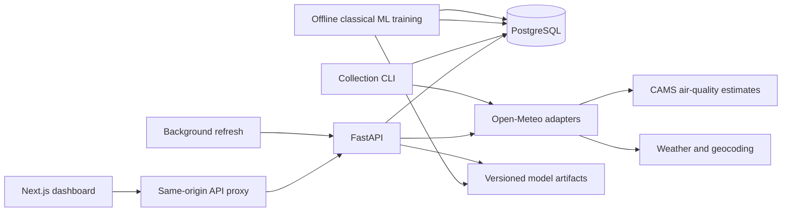

# Architecture

The browser uses `/api` on its own origin. Next.js forwards requests to FastAPI; the backend hostname is never exposed as a browser-only container name. PostgreSQL stores cities, source estimates, weather, ingestion jobs, model registrations and every generated forecast/value. Alembic owns schema initialization. Environment settings configure database, CORS, source timeouts, cache and scheduler.

Integration adapters validate timestamps, array lengths and units. Data is normalized to UTC and duplicate city/timestamp/source entries are upserted. Future third-party AQ forecasts never become historical observations. Retrieval timestamps preserve data freshness. A bounded process cache coalesces repeated upstream requests; persisted observations support useful degraded behavior.

The training process is independent of the API. It builds direct horizon examples, purges overlapping targets across temporal partitions, compares classical estimators against simple baselines and stores a feature schema, evaluation metadata and artifact. API inference loads the registered artifact and produces 72 hourly values. Model coverage is explicit and unsupported cities retain access to source data.

The frontend provides an overview, detailed city profile, forecast studio, map explorer, comparison workspace, model intelligence, data explorer and operational status. Shared city state, query hooks, charts, map, source/freshness and feedback components keep all screens consistent. Heavy charts/maps load on the client.

The initial scheduler and cache are process-local. Run one API worker when scheduling is enabled. A multi-worker deployment needs a single scheduler process or shared job ownership before horizontal scaling. Database constraints protect observation and forecast uniqueness; they do not make multiple independent schedulers a distributed system.
